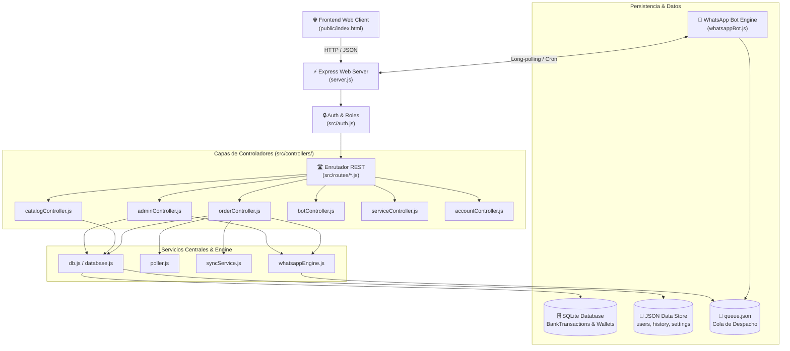
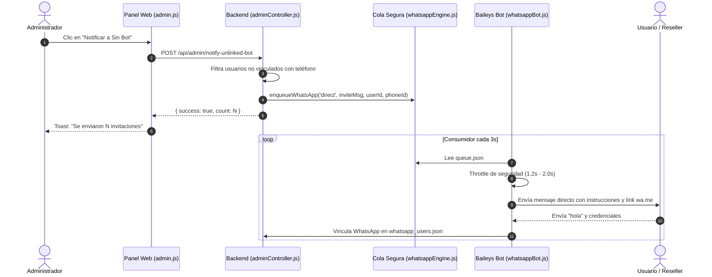

# 🕸️ GRAPHIFY: MAPA DE RELACIONES, DEPENDENCIAS Y ARQUITECTURA

> **Sistema:** MegaUnlockPhone & DigitalPass Panel
> **Generado vía:** Skill `graphify` (AST & Dependency Mapping)
> **Fecha:** 2026-10-14

---

## 🧭 1. Grafo de Arquitectura General

---

## 📦 2. Modularización del Frontend (`public/js/`)

Cada subsistema del cliente web está desacoplado y versionado para carga modular:

| Archivo | Responsabilidad | Dependencias | Estado de Modularidad |
|---|---|---|---|
| `api.js` | Abstracción de llamadas `fetch` con headers de servidor y token | Ninguna | ✅ Desacoplado |
| `state.js` | Estado reactivo en memoria: token, usuario, rol, server activo | `localStorage` | ✅ Desacoplado |
| `utils.js` | Formateo de moneda, escape HTML, copiado al portapapeles | Ninguna | ✅ Reutilizable |
| `notifications.js` | Sistema de Toasts y Alertas visuales Pro Max | DOM / Lucide | ✅ Desacoplado |
| `searchEngine.js` | Motor de búsqueda inteligente de catálogo y debounce | DOM | ✅ Desacoplado |
| `products.js` | Render de categorías, servicios, precios especiales y carrusel | `api.js`, `state.js` | ✅ Modular |
| `orders.js` | Realización de pedidos, validaciones IMEI y sincronizador en vivo | `api.js`, `state.js` | ✅ Modular |
| `recharge.js` | Flujo Fintech SPEI de dos pasos, bovedas y desbloqueo de clave | `api.js`, `state.js` | ✅ Modular |
| `recharges.js` | Historial lateral de transacciones y estados bancarios | `api.js` | ✅ Modular |
| `ticket.js` | Generador de tickets de entrega HTML2Image y Canvas | DOM / Canvas | ✅ Modular |
| `warnings.js` | Avisos críticos por servicio y modal preventivo | `api.js` | ✅ Modular |
| `admin.js` | Gestión de resellers, márgenes, invitaciones al Bot y respaldos | `api.js`, `state.js` | ✅ Modular |

---

## 🔀 3. Mapeo de Flujos de Mensajería y Bot de WhatsApp

---

## 🛡️ 4. Reglas de Integridad y Contingencia (AGENTS Blueprint)
1. **Atribución de Wallet Atómica:** Los balances residen en `users.json` / SQLite y se auditan antes de enviar payloads a proveedores (`latamgsm.com` y `unlockerfast.com.mx`).
2. **Auto-Reembolso (`processRefund`):** Si una orden en proceso es cancelada o rechazada, el poller o actualización manual devuelve el crédito cobrado con el flag `isRefunded = true`.
3. **Rescate sin Bot:** En caso de caída de WhatsApp, `/api/verify-account` permite autenticación y rescate de cuentas sin bloquear a los resellers.
4. **Importación Segura de Pedidos (`/api/history/add`):** Permite a usuarios y resellers importar órdenes legítimas generadas en el servidor remoto asignándolas estrictamente a su cuenta (`userId`), sin permitir sobrescribir órdenes ajenas.
5. **Restricción de Tickets Manuales:** El generador de comprobantes manuales (`btnCustomTicket`) queda reservado con permiso exclusivo de administrador para evitar falsificación de recibos por clientes regulares.
