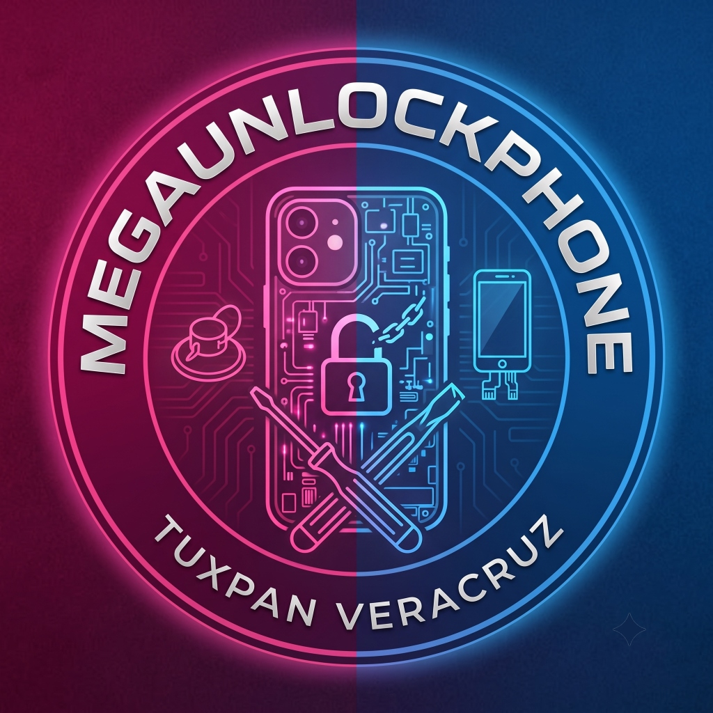

<p align="center">
  
</p>

# MegaUnlockPhone - Panel Cliente Dhru & DigitalPass

> 📘 **DOCUMENTACIÓN MAESTRA DEL SISTEMA:**
> - [AGENTS.md](file:///home/angel/Projects/REPOS/dhru-client-web/AGENTS.md): **Blueprint técnico principal para Agentes de IA y Desarrolladores** (Seguridad de saldos, Prepared Statements anti SQL-injection, endpoints de contingencia, historial de commits y enlaces directos).
> - [Architecture.md](file:///home/angel/Projects/REPOS/dhru-client-web/Architecture.md): **Mapa del proyecto y guía de configuración de servidores** (Estructura de carpetas, modificación de endpoints/APIKEYS en `settings.json`, y patrones de modularidad).

**Sitio Web Principal:** [https://megaunlockphone-panel.alwaysdata.net/](https://megaunlockphone-panel.alwaysdata.net/)  
**Portal DigitalPass (Streaming & IA):** [https://megaunlockphone-panel.alwaysdata.net/digital-pass](https://megaunlockphone-panel.alwaysdata.net/digital-pass)


Plataforma web unificada para la comercialización de servicios de telecomunicaciones (desbloqueo de red IMEI, servidores, FRP/Bypass) y servicios digitales (cuentas de Streaming, herramientas de Inteligencia Artificial, licencias de software y gaming).

## Servidores de Proveedores Integrados
El panel soporta múltiples servidores Dhru configurables desde `data/settings.json` o desde el Panel Admin:
- **Servidor 1 (MEGA-SERVER):** LatamGSM (Recargas directas Free Fire, servicios IMEI y Server).
- **Servidor 2 (ALPHA-SERVER):** POPI-GSM.
- **Servidor 3 (OMEGA-SERVER):** UnlockerFast (Catálogo masivo con cientos de servicios de Streaming, IA y herramientas).

## 🚀 Nuevas Funcionalidades y Mejoras Arquitectónicas

- **API Bridge Universal & Compatibilidad Nativa DHRU Fusion (`/api/v1/*` & `/api/v1/sX/dhru`)**:
  - Tu panel opera como **proveedor puente pasivo transparente**: clientes externos, bots o forks pueden conectarse usando los parámetros estándar de la API de Dhru Fusion (`action=accountinfo`, `imeiservicelist`, `serverservicelist`, `fileservicelist`, `placeimeiorder`, `getimeiorder`, etc.).
  - **Endpoints Dedicados por Servidor**:
    - **Servidor 1 (MEGA-SERVER / Desbloqueos & Gaming)**: `POST /api/v1/s1/dhru` y REST `/api/v1/s1/*`.
    - **Servidor 3 (OMEGA-SERVER / Software, Licencias & Herramientas)**: `POST /api/v1/s3/dhru` y REST `/api/v1/s3/*`.
    - Endpoint genérico: `POST /api/v1/dhru` con selección vía header `X-Server-Id`.
  - **Precios Calculados Transparentes**: El catálogo DHRU devuelto expone directamente el precio de venta final en MXN (con comisiones y tipo de cambio ya aplicados), garantizando compatibilidad 1-a-1 sin sorpresas en facturación.
  - **Llaves API Criptográficas (`mup_live_...`)**: Generación y revocación segura con hashes SHA-256 en almacenamiento local.

- **Seguridad de Lista Blanca de IPs (IP Whitelist con Auto-Binding)**:
  - **Auto-Binding en Primera Conexión**: La primera petición realizada con una nueva API Key vincula automáticamente la IP pública del cliente a su cuenta, evitando configuraciones manuales complejas.
  - **Gestión Completa en Perfil de Usuario**: Botones para agregar IPs manualmente, eliminar IPs existentes o resetear el auto-bind para revincular un nuevo servidor.
  - **Soporte Detrás de Reverse Proxies**: Soporte completo para cabeceras `X-Forwarded-For` en servidores bajo Phusion Passenger / AlwaysData con `app.set('trust proxy', true)`.

- **Arquitectura de Separación Estricta: Grupo Real vs. Grupo Personalizado**:
  - **Aislamiento Financiero**: Las comisiones, markups y márgenes de ganancia (`group_markups.json`) se calculan **estrictamente sobre el grupo original del proveedor upstream** (`_ORIGINAL_GROUP`).
  - **Organización Visual Limpia**: El grupo personalizado (`_CUSTOM_GROUP`) es exclusivo para filtrado de catálogo, navegación y estética en UI, eliminando por completo cualquier riesgo de distorsión o corrupción en precios de venta.

- **Experiencia de Usuario (UI/UX) Refinada**:
  - **Botón de Perfil Integrado**: Perfil de usuario con avatar, nombre, detalles de billeteras independientes (Server 1 y 3), gestión de API Key e historial.
  - **Modales Despejados**: Botón "X" de cierre aislado y accesible en la esquina superior derecha; controles administrativos (como *[Admin] Ocultar IMEI*) ubicados discretamente junto a los campos respectivos sin estorbar al cliente final.
  - **Exclusión Mutua de Secciones**: Corrección del solapamiento de pantallas al recargar saldo o consultar credenciales.
  - **Cache-Busting Forzado (`?v=55`)**: Parámetros de versión en assets estáticos para garantizar que dispositivos móviles reciban siempre la última versión sin depender de la caché del navegador.

## 🏗️ Nueva Arquitectura Modular
El servidor se está refactorizando en la carpeta `src/` para separar la lógica masiva de `server.js` y facilitar su mantenimiento:
- `src/db.js`: Manejo de la caché y persistencia JSON.
- `src/payments.js`: Lógica unificada de liquidez SPEI.
- `src/history.js`: Controlador del historial y devoluciones.
- `src/syncService.js`: Motor central unificado de sincronización y peticiones (bulk order status) a servidores Dhru/GSM.
- `paymentRouter.js`: Enrutador avanzado SPEI basado en la liquidez y reglas de los proveedores.

### Modularización del Frontend (Vanilla JS)
Para evitar mantener un archivo gigante monolítico y al mismo tiempo no romper los _closures_ y variables globales en el sistema de eventos actual en `index.js`, se implementó una estrategia de extracción progresiva usando Inyección de Dependencias (Namespace Pattern `window.MegaApp`):
- **`public/js/state.js`**: Nuevo gestor de estado global (`window.MegaApp.State`) encargado de centralizar variables críticas como Tokens, Sesión y Configuraciones compartidas, evitando la colisión de variables globales.
- **`public/js/utils.js`**: Funciones puras extraídas para el formateo de precios (MXN), sanitización XSS (`escapeHtml`) y coloreado inteligente de strings del servidor (`colorizeServerResponse`).
- **`public/js/api.js`**: Envoltorio asíncrono para llamadas `fetch`.
- **`public/js/notifications.js`**: Sistema híbrido (Dual) para sobrescribir `window.alert` con modales bloqueantes o notificaciones *Toast*.
- **`public/js/recharges.js`**: Lógica extraída de las interfaces y procesos de recargas manuales.
- **`public/js/ticket.js`**: Controlador inyectado para la gestión de logotipos y configuración del ticket de WhatsApp, completamente aislado del monolito.

### Optimizaciones de Rendimiento UI
- **Reducción de Lag/Tirones**: Se ajustó la frecuencia del `setInterval` de sincronización en segundo plano de 15 a 60 segundos para evitar bloqueos del DOM mientras el administrador navega.
- **Yielding (Sincronización Asíncrona)**: Los procesos pesados de renderizado masivo (cientos de componentes en catálogo y grupos) ahora ceden tiempo al *Event Loop* (usando `setTimeout` o Promesas), permitiendo que el navegador pinte los `spinners` de *"Sincronizando..."* o *"Cargando grupos..."* en lugar de congelar la pestaña.
- **Búsqueda Avanzada**: El motor de búsqueda (`public/js/searchEngine.js`) ahora soporta búsqueda multi-palabras (lógica AND en lugar de coincidencia exacta) y ordena los resultados priorizando siempre las coincidencias exactas en la parte superior.

## 🤖 Sistema de Bot de WhatsApp como Demonio
El bot de WhatsApp (`whatsappBot.js`) ahora funciona como un demonio continuo (User Service) en AlwaysData, a través del script corregido `start_bot.sh`.
Para evitar que el servidor web se duerma y deje de chequear el estado de los pedidos:
- El bot ejecuta un ping (`GET /api/cron/sync`) de manera ininterrumpida cada 3 minutos.
- Este ping despierta a `server.js`, el cual usa `syncService.js` para iterar sobre las órdenes `pending`.
- Si alguna orden cambió su estado en el proveedor, el servidor lo detecta, escribe el cambio en `queue.json`, y el bot procesa inmediatamente el mensaje de WhatsApp.

## Cambios Recientes y Correcciones Críticas

### Solución al Error "Faltan Varios Campos" en Servicios Free Fire (Servicio 154 - LatamGSM)
Se identificó que ciertas actualizaciones en la API de Dhru Fusion (v2025.03) generaron un comportamiento estricto en la recepción de campos personalizados (`CUSTOMFIELD`). 

**El problema:** 
Al enviar solicitudes mediante XML, el servidor respondía constantemente con el error `Faltan Varios Campos` en el servicio 154 (Free Fire - Direct Topup 210 Diamonds), a pesar de que el `PlayerID` se estaba enviando correctamente dentro de sub-etiquetas XML (`<CUSTOMFIELD><PlayerID>...</PlayerID></CUSTOMFIELD>`).

**La solución:**
Se implementó un parche en el código (`server.js`) para formatear el campo `CUSTOMFIELD` según el estándar estricto esperado por las versiones más recientes de Dhru Fusion API. En lugar de usar XML anidado, **el objeto JSON de los campos personalizados se codifica en Base64** y se envía dentro de la etiqueta `<CUSTOMFIELD>`.

*Ejemplo del XML generado ahora (Servidor 1):*
```xml
<PARAMETERS>
  <ID>154</ID>
  <IMEI>11975173546</IMEI>
  <QNT>1</QNT>
  <CUSTOMFIELD>eyJQbGF5ZXJJRCI6IjExOTc1MTczNTQ2In0=</CUSTOMFIELD>
</PARAMETERS>
```
*(Donde la cadena en Base64 corresponde a `{"PlayerID":"11975173546"}`)*

**Protección a otros servidores:**
Dado que otros servidores (como UnlockerFast - Servidor 3) pueden estar corriendo versiones antiguas de la API que aún requieren XML clásico, el parche de Base64 se aplicó **únicamente para el Servidor 1**, manteniendo compatibilidad total con el resto de los proveedores.

## Despliegue
Para aplicar cambios al panel en producción:
1. Subir los cambios a la rama `main`.
2. Ejecutar el script `deploy_server.py` para transferir los cambios vía SSH.
3. El panel se reiniciará automáticamente.

### Sistema Anti-Ban y Prevención de "Esperando el mensaje" (Baileys)
Se implementó un parche en el núcleo del bot (`whatsappBot.js`) para evitar que la aplicación sature a los destinatarios con ráfagas de mensajes:
- **Cola de Mensajes (Queueing)**: Los mensajes salientes se colocan en una cola secuencial en lugar de enviarse en paralelo.
- **Retraso Dinámico**: El bot inyecta un retraso aleatorio de **1.5 a 2.5 segundos** entre cada mensaje, simulando un comportamiento humano.
- **Sincronización de Presencia**: Antes de disparar el mensaje, el bot envía el estado `composing` (Escribiendo...), lo que obliga al cliente de WhatsApp destino a sincronizar las llaves de cifrado E2E de Baileys, erradicando el bug visual de "Esperando el mensaje".

### Corrección de Bug de Toggles de Servicio (Modo OFF)
Se corrigió un bug por el cual ciertos servicios no se mostraban visualmente como apagados (Modo OFF) en el panel del cliente, a pesar de que el administrador había pulsado el botón.
**Causa:** La base de datos local guardaba el ID del servicio desactivado como cadena (`"114377"`), mientras que algunas respuestas de la API de Dhru devolvían el `SERVICEID` en formato numérico (`114377`). La comprobación `includes()` de JavaScript fallaba por usar comparación estricta.
**Solución:** Se implementó una coerción explícita (`String(realServiceId)`) en `catalogController.js` y se optimizó el código extrayendo la lectura de archivos de disco (`fs.readFileSync`) fuera de los ciclos (loops) iterativos masivos, incrementando enormemente el rendimiento del endpoint del catálogo. Además, se añadió un estilo visual estricto de tipo "Cinta Policial de Clausurado" sobre la tarjeta del servicio usando CSS (`.disabled-card`) y se implementó validación de cache-busting en el index para forzar a los clientes web a descargar la última interfaz.
